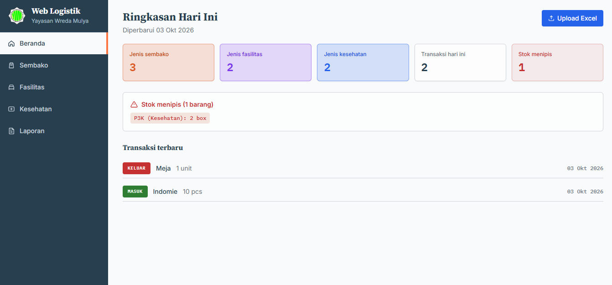
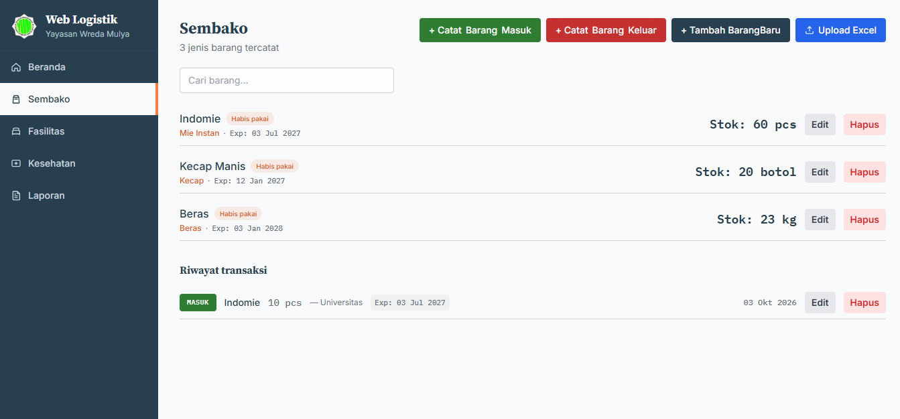
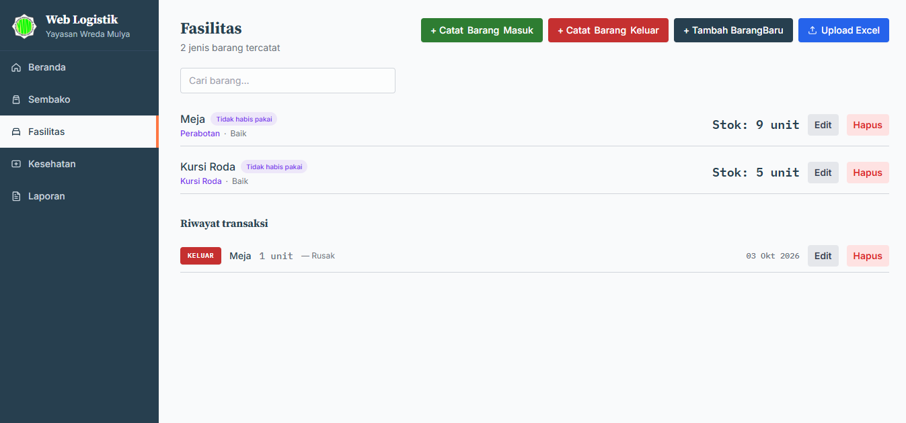
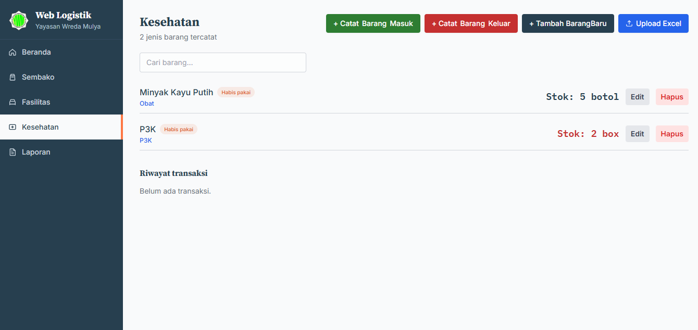
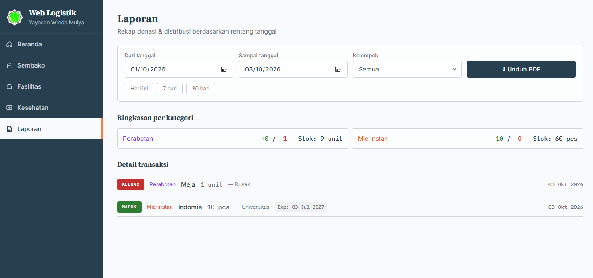

# **Yayasan Wredha Mulya Logistics Website**

`Web-Based Inventory & Logistics Management System`

## 📌 Overview

Web Logistik YWM is a web-based logistics and inventory management system developed to help manage the inventory and distribution of goods at Yayasan Wredha Mulya.

The system organizes inventory into three main groups: Sembako, Fasilitas, and Kesehatan. Users can manage stock, record incoming and outgoing transactions, monitor low-stock items, and generate logistics reports based on a selected date range.

The application uses Firebase Firestore for real-time data storage and synchronization, providing an up-to-date view of inventory and transaction data.

## 👨‍💻 Developed By

- `Ivan Roberto Halim`

## ⚙️ Features

### 📦 Inventory Management

- 🛒 Sembako inventory management
- 🪑 Fasilitas inventory management
- 💊 Kesehatan inventory management
- ➕ Add new inventory items
- ✏️ Edit existing inventory items
- 🗑️ Delete inventory items
- 📊 Real-time stock monitoring
- ⚠️ Low-stock detection
- 📅 Expiry date tracking
- 🏷️ Category and unit management
- 🔧 Condition management for facility items

### 🔄 Transaction Management

- 📥 Record incoming goods
- 📤 Record outgoing goods
- 📝 Add transaction details such as source/recipient and notes
- ✏️ Edit transaction records
- 🗑️ Delete transaction records
- 🔄 Automatically update stock based on transactions
- ↩️ Automatically adjust stock when transactions are deleted or modified

### 📊 Dashboard

- 📦 Total types of Sembako
- 🪑 Total types of Fasilitas
- 💊 Total types of Kesehatan
- 🔄 Today's transaction count
- ⚠️ Low-stock item monitoring
- 🕐 Recent transaction display

### 📑 Excel Import

- 📥 Download Excel data template
- 📤 Import `.xlsx`, `.xls`, and `.csv` files
- 🔍 Preview imported data before saving
- 🔄 Detect existing items and update their data
- ➕ Automatically add new inventory items
- 📝 Automatically record imported transactions
- 🚫 Avoid unnecessary updates for unchanged data

### 📄 Reports

- 📅 Filter reports by date range
- 🗂️ Filter reports by inventory group
- 📊 Category-based transaction summary
- 📈 Incoming and outgoing quantity summary
- 📦 Current stock summary
- 📋 Detailed transaction list
- ⬇️ Export logistics reports to PDF

## 🧩 Core Modules

- `Dashboard` → Overview of inventory statistics, recent transactions, and low-stock items
- `Sembako` → Management of food and daily-use inventory
- `Fasilitas` → Management of reusable facilities and equipment
- `Kesehatan` → Management of medicine, vitamins, medical supplies, and health-related inventory
- `Laporan` → Transaction filtering, inventory summaries, and PDF report generation
- `Inventory CRUD` → Add, edit, and delete inventory records
- `Transaction CRUD` → Add, edit, and delete incoming/outgoing transactions
- `Excel Import` → Import and synchronize inventory data from Excel/CSV files
- `Firestore Listener` → Real-time synchronization of inventory and transaction data

## 🛠️ Tech Stack

- 💻 Web Development: `HTML5 + JavaScript`
- 🎨 UI Framework: `Tailwind CSS`
- 🔥 Database: `Firebase Firestore`
- 📊 Excel Processing: `ExcelJS + SheetJS (xlsx)`
- 📄 PDF Generation: `jsPDF + jsPDF AutoTable`
- 🔤 Fonts: `Inter + Source Serif Pro + IBM Plex Mono`

## 🧠 How It Works

1. Users can access the main sections through the navigation menu:
   - **Beranda**
   - **Sembako**
   - **Fasilitas**
   - **Kesehatan**
   - **Laporan**
2. Inventory items can be added, edited, or deleted according to their respective categories.
3. When an incoming transaction is recorded, the system automatically **increases the item's stock**.
4. When an outgoing transaction is recorded, the system automatically **decreases the item's stock**.
5. Transaction changes or deletions automatically recalculate the affected stock.
6. Excel files can be imported to add or update inventory data and record related transactions.
7. The **Laporan** section allows users to select a date range and inventory group.
8. Filtered report data can be exported as an **A4 landscape PDF** containing a category summary and detailed transaction records.

## 📸 Project Showcase

  
  
  
  
  

- Dashboard
- Sembako Management
- Fasilitas Management
- Kesehatan Management
- Logistics Report

## 📄 Notes

This project was developed as a web-based logistics management system for Yayasan Wredha Mulya Yogyakarta, with the purpose of organizing inventory data, recording goods movement, monitoring stock availability, and simplifying logistics reporting.
